# Pruebas de Aceptacion (P1 a P12) - RoboFix

Este documento contiene el registro de ejecucion y los resultados obtenidos para cada una de las pruebas de aceptacion exigidas en la seccion 5 del taller.

---

## Tabla Resumen de Resultados

| Prueba | Accion | Resultado Esperado | Estado |
| --- | --- | --- | --- |
| P1 | Consultar el robot | Mostrar codigo, nombre, energia y modo. | Superada |
| P2 | Ejecutar diagnostico | Obtener los datos interpretados mediante Adapter. | Superada |
| P3 | Consultar inventario desde ambos talleres | Ambos muestran las mismas cantidades. | Superada |
| P4 | Descontar una bateria desde un taller | El otro taller refleja el descuento. | Superada |
| P5 | Intentar descontar mas repuestos de los disponibles | Rechazar la operacion sin alterar el inventario. | Superada |
| P6 | Configurar energia en -10 | Rechazar el valor. | Superada |
| P7 | Configurar energia en 150 | Rechazar el valor. | Superada |
| P8 | Configurar un modo desconocido | Rechazar el modo y conservar el estado anterior. | Superada |
| P9 | Guardar, modificar y restaurar el robot | Recuperar la energia y el modo guardados. | Superada |
| P10 | Restaurar sin haber guardado | Mostrar un mensaje y mantener el estado actual. | Superada |
| P11 | Reparar sin repuestos suficientes | Informar el fallo y evitar una reparacion parcial. | Superada |
| P12 | Revisar `EscanerAntiguo` | Confirmar que no fue modificado. | Superada |

---

## Detalle de Cada Prueba con Evidencia de Consola

### P1: Consultar el robot
- **Accion:** Seleccionar la opcion `1. Ver robot`.
- **Salida de consola:**
  ```text
  Opcion: 1

  Codigo: RX-01
  Nombre: Explorador
  Energia: 80
  Modo: NORMAL
  ```
- **Captura:**
  <br>
  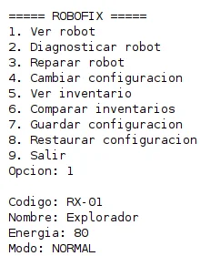
- **Resultado:** Muestra todos los atributos del robot correctamente estructurados.

---

### P2: Ejecutar diagnostico
- **Accion:** Seleccionar la opcion `2. Diagnosticar robot`.
- **Salida de consola:**
  ```text
  Opcion: 2

  --- DIAGNOSTICO ---
  Robot: RX-01
  Componente: BATERIA
  Estado: CRITICO
  Consumo reportado: 15
  ```
- **Captura:**
  <br>
  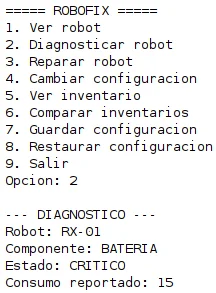
- **Resultado:** Los datos fueron obtenidos a traves del `AdaptadorEscaner` e interpretados desde el objeto limpio `ResultadoDiagnostico`.

---

### P3: Consultar inventario desde ambos talleres
- **Accion:** Seleccionar la opcion `6. Comparar inventarios` al iniciar la aplicacion.
- **Salida de consola:**
  ```text
  Opcion: 6

  Inventario taller 1:
  MOTOR: 3
  SENSOR: 4
  BATERIA: 2

  Inventario taller 2:
  MOTOR: 3
  SENSOR: 4
  BATERIA: 2
  ```
- **Captura:**
  <br>
  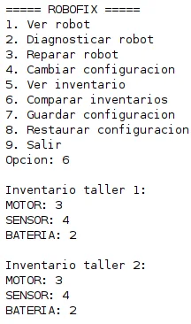
- **Resultado:** Ambos talleres acceden a la misma instancia Singleton y muestran exactamente el mismo stock inicial.

---

### P4: Descontar una bateria desde un taller
- **Accion:** Reparar el robot con `taller1` (opcion 3) y luego consultar los inventarios (opcion 6).
- **Salida de consola:**
  ```text
  Opcion: 3

  Robot reparado correctamente.

  Opcion: 6

  Inventario taller 1:
  MOTOR: 3
  SENSOR: 4
  BATERIA: 1

  Inventario taller 2:
  MOTOR: 3
  SENSOR: 4
  BATERIA: 1
  ```
- **Captura:**
  <br>
  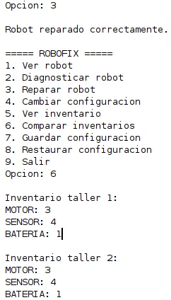
- **Resultado:** Al descontar una pieza desde el taller 1, el taller 2 refleja inmediatamente que el stock bajo de 2 a 1.

---

### P5 y P11: Intentar descontar mas repuestos de los disponibles / Reparar sin stock
- **Accion:** Reparar consecutivamente hasta agotar el stock de baterias (quedan en 0) e intentar reparar una vez mas.
- **Salida de consola:**
  ```text
  Opcion: 3

  No se pudo reparar el robot: Stock insuficiente de 'BATERIA'. Disponible: 0, requerido: 1

  Opcion: 6

  Inventario taller 1:
  MOTOR: 3
  SENSOR: 4
  BATERIA: 0

  Inventario taller 2:
  MOTOR: 3
  SENSOR: 4
  BATERIA: 0
  ```
- **Captura:**
  <br>
  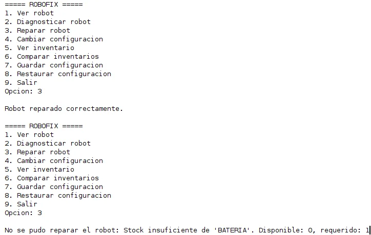
- **Resultado:** La operacion se rechaza, el sistema no descuenta piezas, el stock no queda en numeros negativos y se notifica el fallo sin falsos positivos de exito.

---

### P6: Configurar energia en -10
- **Accion:** Opcion `4. Cambiar configuracion`, ingresar `-10` y modo `NORMAL`.
- **Salida de consola:**
  ```text
  Opcion: 4

  Nueva energia: -10
  Nuevo modo: NORMAL

  Error: La energia debe estar en el intervalo de 0 a 100. Valor recibido: -10
  Se conserva la configuracion anterior.
  ```
- **Captura:**
  <br>
  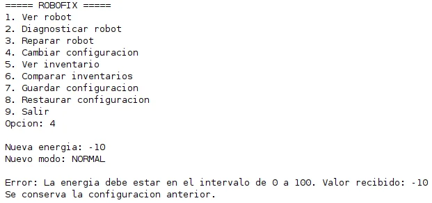
- **Resultado:** Se rechaza el valor por estar fuera de rango y el robot mantiene su energia anterior intacta.

---

### P7: Configurar energia en 150
- **Accion:** Opcion `4. Cambiar configuracion`, ingresar `150` y modo `NORMAL`.
- **Salida de consola:**
  ```text
  Opcion: 4

  Nueva energia: 150
  Nuevo modo: NORMAL

  Error: La energia debe estar en el intervalo de 0 a 100. Valor recibido: 150
  Se conserva la configuracion anterior.
  ```
- **Captura:**
  <br>
  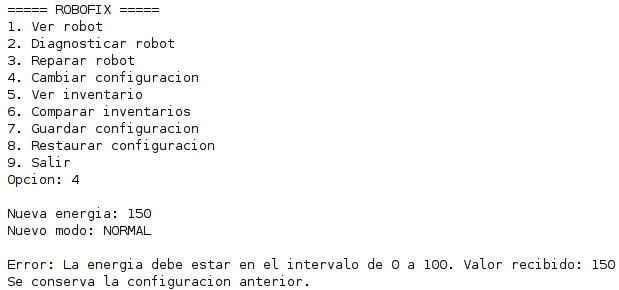
- **Resultado:** Se rechaza el valor superior a 100 y se preserva el estado del robot.

---

### P8: Configurar un modo desconocido
- **Accion:** Opcion `4. Cambiar configuracion`, ingresar `60` y modo `DESCONOCIDO`.
- **Salida de consola:**
  ```text
  Opcion: 4

  Nueva energia: 60
  Nuevo modo: DESCONOCIDO

  Error: Modo no reconocido: 'DESCONOCIDO'. Modos permitidos: NORMAL, AHORRO, MANTENIMIENTO.
  Se conserva la configuracion anterior.

  Opcion: 1

  Codigo: RX-01
  Nombre: Explorador
  Energia: 80
  Modo: NORMAL
  ```
- **Captura:**
  <br>
  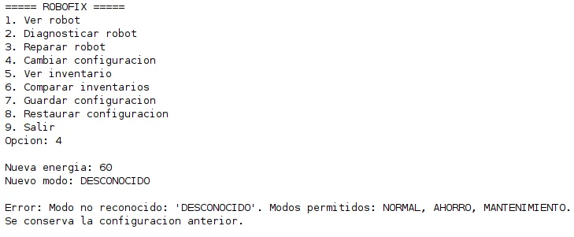
- **Resultado:** La actualizacion se rechaza de forma atomica: como el modo es invalido, la energia tampoco se modifica (se queda en 80 y NORMAL).

---

### P9: Guardar, modificar y restaurar el robot (Patron Memento)
- **Accion:** Guardar configuracion inicial (80, NORMAL), modificar a (50, AHORRO), y luego restaurar.
- **Salida de consola:**
  ```text
  Opcion: 7

  Configuracion actual guardada exitosamente.

  Opcion: 4

  Nueva energia: 50
  Nuevo modo: AHORRO

  Configuracion actualizada.

  Opcion: 1

  Codigo: RX-01
  Nombre: Explorador
  Energia: 50
  Modo: AHORRO

  Opcion: 8

  Configuracion restaurada exitosamente.

  Opcion: 1

  Codigo: RX-01
  Nombre: Explorador
  Energia: 80
  Modo: NORMAL
  ```
- **Capturas:**
  <br>
  Paso 1 - Guardar configuracion:
  <br>
  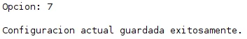
  <br><br>
  Paso 2 - Modificar configuracion:
  <br>
  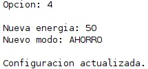
  <br><br>
  Paso 3 - Consultar robot modificado:
  <br>
  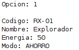
  <br><br>
  Paso 4 - Restaurar configuracion:
  <br>
  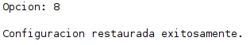
  <br><br>
  Paso 5 - Consultar robot restaurado:
  <br>
  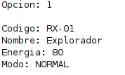
- **Resultado:** Se recupera exitosamente la energia y el modo guardados. El codigo (`RX-01`) y el nombre (`Explorador`) se mantuvieron intactos sin alteracion.

---

### P10: Restaurar sin haber guardado
- **Accion:** Iniciar el programa y presionar de inmediato la opcion `8. Restaurar configuracion`.
- **Salida de consola:**
  ```text
  Opcion: 8

  No existe ninguna configuracion guardada para restaurar.
  ```
- **Captura:**
  <br>
  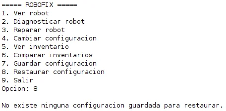
- **Resultado:** Muestra un mensaje claro y comprensible sin arrojar excepciones ni alterar el robot.

---

### P12: Revisar `EscanerAntiguo`
- **Accion:** Verificacion del archivo `EscanerAntiguo.java`.
- **Comprobacion:** La clase permanece 100% identica a la version original, conservando metodos, retorno delimitado por barras y comentarios.
- **Capturas:**
  <br>
  Codigo original en enunciado:
  <br>
  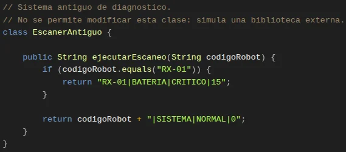
  <br><br>
  Codigo en el proyecto sin modificaciones:
  <br>
  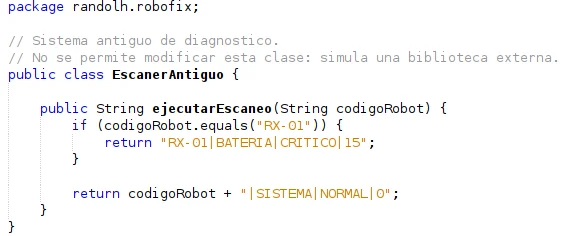
- **Resultado:** Cumple con la restriccion de biblioteca externa intocable.
